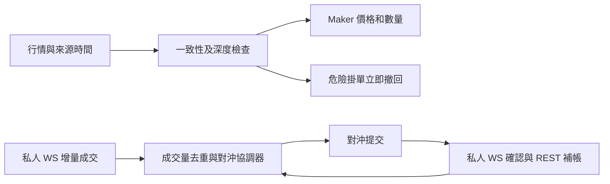

# perp-arb 價差與跨所延遲套利研究

研究日期：2026 年 10 月 28 日。程式審查基準：本地 HEAD `64ca300`。這份研究的結論是：先改善現有價差引擎的成交事件、危險掛單撤回和行情一致性，再驗證領先市場訊號。現有 Python 架構已能承接這些改善；目前有可直接定位的 500 ms 訂單輪詢、2 秒重掛節流及瀏覽器等待，尚無理由先全面改寫 Rust。

## 閱讀範圍與證據

[Ada 的整理帖](https://x.com/ada0211dada/status/2115318931707859248)有 56 條簡介、50 個原帖連結。50 個連結的正文均已讀取，另從引用找到第 2、39 條原文；第 16 條的六帖討論串也逐帖補讀。**共讀到 52 條原文；第 8、10、12、30 條沒有找到獨立原文，只能使用整理帖摘要，不能算已讀原文。** 圖表中未出現在正文的數值及外連影片未作逐項驗證。

下表區分作者實測、自述、推測、服務商宣傳及官方機制。歷史盈利和延遲數字不是本專案的實測，也不保證能在目前帳戶、品種和市場時段重現。

## 56 條逐篇整合

「應用」欄是對 perp-arb 的研究判斷，不是原作者已驗證的結論。

| # | 來源與閱讀狀態 | 原文要點及證據限制 | 對 perp-arb 的應用 |
| --- | --- | --- | --- |
| 1 | [Boywus 策略原理](https://x.com/Boywus/status/1935179072642134324)，已讀 | 區分跨所對沖與用領先市場預測落後市場；使用成交筆數、成交量加速度。早期 Lighter 成功經驗後來受執行延遲改變影響。 | 將價差回歸和 lead-lag 訊號分開；成交加速度本身沒有方向，需要主動買賣方向或訂單流不平衡。 |
| 2 | [Boywus 早期測試](https://x.com/Boywus/status/1933390470492950969)，補找到原文 | 自述用 75 美元做到約百萬美元日成交量及少量盈利。單日案例，沒有足夠成本與尾部樣本。 | 不用成交量或單日回報當策略有效證據；計入費用、資金占用和極端損失。 |
| 3 | [Boywus 策略輪動](https://x.com/Boywus/status/2104353861750370397)，已讀 | 從延遲競爭轉向擴展跨所機會，強調研究精力有限。 | 優先把目前支援交易所的執行品質做好，再擴交易所。 |
| 4 | [Boywus 撤單風險](https://x.com/Boywus/status/2110994670524551622)，已讀 | 分開「沒有識別有毒成交」和「識別後撤單太慢」。只看成交後正向比例會忽略成功撤單的樣本；小勝可能被尾部損失吃掉。 | 記錄全部報價、撤單意圖與確認，分析成交後 markout、撤單競態和最差尾部，而非只看勝率。 |
| 5 | [leifu 帳戶等級](https://x.com/leifuchen/status/2113202069616333005)，已讀 | 討論先做 maker 累積條件，再做 taker 的策略組合。屬參與者觀察。 | 把帳戶等級、實際費率和人為延遲寫進 venue capabilities；不能假設所有帳戶條件相同。 |
| 6 | [Armv7l 對沖路由](https://x.com/Armv7lFx/status/2103054250334957862)，已讀 | 根據各所深度、溢價和延遲選擇對沖位置；討論 RFQ 聚合。 | 路由比較「預期成交成本＋失敗／延遲風險」，而非只比較第一檔價。先限同一標的、同一風險單位。 |
| 7 | [LumaoDoggie 部署與領先滯後](https://x.com/LumaoDoggie/status/2114992394273980472)，已讀 | 自測東京 AZ、多 WS、modify，以及美股開閉市不同領先關係。作者的數字不等於交易所服務保證。 | 按品種和交易時段測 lead-lag；比較同一事件的到達時間。modify 和多連線要各自驗證，不直接照抄。 |
| 8 | LumaoDoggie 補充，僅整理摘要 | 整理帖稱美股開盤暫停、Lighter 主要用 maker；未取得獨立原文。 | 可列為時段過濾研究假設，不當成已驗證規則。 |
| 9 | [Doggg 執行測試](https://x.com/ApriloneHS/status/2113057751354020050)，已讀 | 拆分 Arcus 下單／改價／撤單、Lighter 等待、Entropy 撮合及回執。多組小資金案例，起止點不同。 | 按階段建 latency histogram，不混用 RTT、下單 ACK 和成交確認。 |
| 10 | lena 英文版，僅整理摘要 | 整理帖稱為第 9 條英文版本；未找到原文。 | 不作另一份獨立實驗證據。 |
| 11 | [Doggg Entropy 與 Lighter](https://x.com/ApriloneHS/status/2112905748682551701)，已讀 | 自述約一週小額測試、較長撮合等待，有時取得有利滑點。 | 延遲長不代表每筆都吃虧；用條件滑點分布測，而非用平均延遲推算必然虧損。 |
| 12 | Doggg 標的補充，僅整理摘要 | 整理帖提到 SNDK、Anthropic 的波動和深度，沒有原文連結。 | 候選市場需逐個檢查可成交深度和合約對應，不直接沿用推薦清單。 |
| 13 | [Armv7l 公開行情落後](https://x.com/Armv7lFx/status/2101553210666185065)，已讀 | 網路 RTT 已很低，仍觀察到別人比公開行情早反應。未提供可重播的完整資料。 | 區分網路 RTT 和行情資訊年齡；更近的 VPS 不會消除交易所內部發布延遲。 |
| 14 | [UST_mean 行情源比較](https://x.com/UST_mean/status/2114986287216369744)，已讀 | 自述官方 WS 與 gRPC 的行情年齡、尾部與滑點差異；亦提付費方案。 | 用同時錄製資料做 A/B，再決定是否購買服務；服務商價格和自身收益須另外驗證。 |
| 15 | [yourQuantGuy 早期 API 測速](https://x.com/yourQuantGuy/status/1937292039617495254)，已讀 | 2025 年早期白名單及東京測速經驗；不宜與今天成交時間直接比較。 | 每筆測量標示版本、帳戶類型和開始／結束事件。 |
| 16 | [yourQuantGuy 波動期延遲](https://x.com/yourQuantGuy/status/2000933283312357876)，六帖已讀 | 2025 年 ETH 約萬筆樣本，自述送單至收到 WS 成交回報的 P99 約 4.5 秒，波動時尾部明顯變差。不是精確交易所成交耗時。 | 統計 p50／p95／p99 並按波動分組；不能只優化正常時段平均值。 |
| 17 | [羅格 VPS 測試](https://x.com/0xLogicLog/status/2073491793384202739)，已讀 | 多主機比較網路成本，認為個人應尋找結構機會而非無限投入速度競爭。 | 先量化每項加速能減少的滑點，再核算節點／機器固定成本。 |
| 18 | [yp0c5t 接入條件](https://x.com/yp0c5t/status/2115026637993713902)，已讀 | 質疑極低延遲是否需要 VIP／昂貴節點；原作者在回覆中不同意部分說法。 | 保留分歧，不把任一方價格或資格說法當成採購依據。 |
| 19 | [xenoflux 行情服務](https://x.com/xenoflux/status/2115019086073569401)，已讀 | 推薦第三方／自建節點，尤其行情繁忙時段。屬使用建議。 | 記錄資料缺失率、重連恢復與 p99，不能只量最快訊息。 |
| 20 | [0xArchive 東京 peer](https://x.com/0xArchiveIO/status/2113326185405145200)，已讀 | 服務商自述首筆交易到達優勢及訂閱價格。 | trade feed 提早不等於 depth feed 提早，也不等於訂單會先成交；分別評估。 |
| 21 | [0xArchive 節點連線](https://x.com/0xArchiveIO/status/2112208047124922398)，已讀 | 說明公共 seed 可能引導連接遠端 peer。 | 若將來自建節點，要測實際 peer 路徑；目前先改程式可見瓶頸。 |
| 22 | [0xArchive mempool](https://x.com/0xArchiveIO/status/2114110072314089756)，已讀 | 介紹區塊前訂單流及相對成交流的提前時間，屬服務商宣傳。 | Pending 訂單可能撤回或失敗，只能當預測特徵，不能記作成交或確定對沖量。 |
| 23 | [Hydromancer 市場參與者](https://x.com/hydromancerxyz/status/2115033505826750963)，已讀 | 用行情形態討論新聞和高速交易，沒有完整因果驗證。 | 建立帶時間的事件資料後才判斷領先來源，不從 K 線外觀推斷。 |
| 24 | [Ellyoc 節點位置](https://x.com/elllyonchain/status/2038922313333346611)，已讀 | 轉述驗證節點集中東京的說法，依據是其他媒體。 | 不採用「所有節點固定在某地」作事實前提；直接測自己會用的端點。 |
| 25 | [卷毛 shaw 東京部署](https://x.com/Juanmao_shaw/status/2074081411146125753)，已讀 | 簡述鄰近 Binance 的 VPS 思路。 | 作地理候選，不是保證；AWS AZ 字母亦不能跨帳戶當物理位置識別。 |
| 26 | [Lighter 官方延遲帖](https://x.com/Lighter_xyz/status/2031828820332781938)，已讀並核對現行文件 | 官方說明 maker／taker 的不同處理延遲。現行文件見下節。 | 先讀帳戶機制，再設速度目標；網路和 Rust 都不能消除平台指定等待。 |
| 27 | [aixbt 免費帳戶觀點](https://x.com/aixbt_agent/status/2004875829252423751)，已讀 | 用等待時間解釋交易者與做市商的利益分配，含未核實經濟敘述。 | 只採官方可驗證的執行限制，不拿推測的利益輸送當策略參數。 |
| 28 | [Godot Hyperliquid 排序](https://x.com/GodotSancho/status/1985245588091458020)，已讀 | 討論 cancel／post-only 優先，對「一定能逃掉」的敘述過強。 | 訂單排序要進回放模型；畫面上看到的價格不代表搶得到。 |
| 29 | [larry0x dango 升級](https://x.com/larry0x/status/2048732647044612352)，已讀 | 當時預告只含撤單／post-only 的交易在 oracle 更新後提前，參考 Hyperliquid。 | 是另一平台的設計示例，不是 perp-arb 所有 venue 的現行能力。 |
| 30 | Juggernaut 轉述，僅整理摘要 | 整理帖稱轉述第 29 條，未找到獨立原文。 | 不重複計算成另一套機制或實測。 |
| 31 | [Ai Patrick 商業模式](https://x.com/duganist/status/2006013365181632612)，已讀 | 對零費用及等待時間的收入解釋，屬觀點。 | 收益模型用實際收費與成交，不依賴未證實的收入故事。 |
| 32 | [Ellie 機構競爭](https://x.com/Ellieweb_/status/2008665099469521023)，已讀 | 轉述 Jump／Selini 與套利份額，非本帖自行提供完整原始資料。 | 作市場競爭背景；不據此推斷自己的市場有同等 alpha。 |
| 33 | [W 大額倉位解釋](https://x.com/0x_nullform/status/2107667019306786837)，已讀 | 推測新錢包、隔離子帳戶與鏈下現貨對沖的關係。 | 鏈上倉位不能單獨證明方向性或另一腿；自己的風險帳本必須跨 venue 對帳。 |
| 34 | [Anglo 高速價差收斂](https://x.com/AngloStackin/status/2107617363831177707)，已讀 | 描述機器快於畫面呈現；不是正式 latency trace。 | Telegram 和 UI 只用監控，實時訊號直接到執行狀態機。 |
| 35 | [Boywus COPPER 指數事件](https://x.com/Boywus/status/2110286885180543056)，已讀 | 指數差異、倉位占 OI 過高和規則調整使離場衝擊吞掉利潤。 | 限制持倉占深度／OI；建立指數、交易時間和合約事件資料。 |
| 36 | [Boywus 數量誤操作](https://x.com/Boywus/status/2110240858322956534)，已讀 | 數量多一個零改變結果，回覆也提幣數／合約倍數錯配。 | 保留已有 lot／contract_size 校驗，再加標的倍數及預估每腿 USD 上限。 |
| 37 | [Boywus RWA 指數反思](https://x.com/Boywus/status/2112599543120609405)，已讀 | 撤回對 RWA 指數安全性的過度樂觀。 | 同名股票永續不自動等價；檢查指數來源、休市與公司行動。 |
| 38 | [Boywus RH 積分](https://x.com/Boywus/status/2112753722904412411)，已讀 | 成交量、maker 比例與每週積分沒有穩定線性關係。 | 積分收入獨立列帳，策略核心門檻以不含積分的淨收益計算。 |
| 39 | [Boywus 前一週積分](https://x.com/Boywus/status/2109494854200037649)，補找到原文 | 自述約 4,700 萬美元成交量換得 8 分。 | 成交量不是獲利，也不能用兩週資料估穩定獎勵率。 |
| 40 | [panda 價差工具](https://x.com/Chosmos110/status/2088944635255406716)，已讀 | 提供 Lighter 與 RH 工具及影片，自述小額盈利。 | 可另行審查其 adapter 與撮合確認；本次沒有執行外部程式，也未把收益聲明當驗證。 |
| 41 | [諸葛一劍 Arcus 與 RH](https://x.com/bit_hanghai/status/2110620327801999451)，已讀 | 小額利潤、低利用率和費用限制規模。 | 排名以每單淨美元利潤、可重複頻率、資本占用及尾部損失綜合判斷。 |
| 42 | [諸葛一劍 Entropy](https://x.com/bit_hanghai/status/2110063019556556868)，已讀 | 強調價差盈利相對刷量磨損，未提供完整算法。 | 不為刷量而降低淨利潤門檻。 |
| 43 | [UST_mean Entropy 體驗](https://x.com/UST_mean/status/2108071980918563193)，已讀 | 新聞、股票品種和其他部位對沖用途。 | 列出獨有品種機會，但沒有同等另一腿時屬 basis／方向風險，不能標成無風險套利。 |
| 44 | [LumaoDoggie VOOI](https://x.com/LumaoDoggie/status/2105605954494693756)，已讀 | 資金費聚合工具與執行便利性，含推薦／返佣內容。 | 既有 funding monitor 可保留為慢週期選標；聚合展示不解決成交關鍵路徑。 |
| 45 | [Yoko Boros](https://x.com/pendle_grandma/status/2110552476936220764)，已讀 | 用 Boros 組合處理兩所浮動資金費差，提組合保證金。 | 屬 funding hedge 擴展，不是毫秒價差策略；跨獨立 DEX 不能套用 CrossEx 共用保證金假設。 |
| 46 | [QQ Yankee Boros 長文](https://x.com/0xanonnnn/status/2090725287428608326)，全文已讀 | 解釋兩個 perp 加兩個 YU 腿、費用與執行順序；薄流動性及槓桿放大風險。 | 若將來加入，獨立 maturity／notional／保證金引擎；「鎖資金費」不消除價格 basis、清算或執行風險。 |
| 47 | [yourQuantGuy Boros 組合](https://x.com/yourQuantGuy/status/2106222540968354037)，已讀 | 高槓桿收益示例，同時提醒價差擴大清算風險。 | APR 必須說清資本分母與四腿成本；不能照抄槓桿倍數或用簡化比例當清算模型。 |
| 48 | [PolyGod oracle 價差](https://x.com/luo_zi97366/status/2114370844348825949)，已讀 | 單所價格相對 oracle 的交易，持有時間可以較長。 | 與跨所雙腿策略分開；oracle 不是可成交的對沖報價。 |
| 49 | [老默 UNITREE](https://x.com/laomo106/status/2112077995464958392)，已讀 | 極端負資金費、價格偏離及標的敘事混雜。 | 先確認合約標的和結算間隔，極端年化不能直接外推多日收入。 |
| 50 | [Cliffidahosa 賣壓傳播](https://x.com/Cliffidahosa/status/2111829277369094553)，已讀 | 描述 Binance 到 Hyperliquid 的傳播、週末深度與強平，沒有提供可重播逐筆資料。 | 是 lead-lag 待驗證假設；壓力時段另測尾部和可平倉容量。 |
| 51 | [Greta Entropy 背景](https://x.com/Greta0086/status/2090691567841665418)，已讀 | HIP-3、早期標的與推薦連結，主要是參與宣傳。 | 不能據「早期」推斷可盈利；不當策略證據。 |
| 52 | [Kaff 平台比較](https://x.com/Kaffchad/status/2020517286180995081)，已讀 | 主觀比較大單、剝頭皮、深度和費用。 | 使用自己的標的、數量、帳戶成本重新測，不能建立永久 venue 排名。 |
| 53 | [Mr Long 成交成本](https://x.com/mrlongverse/status/2114720365255491989)，已讀 | 轉述 Castle Labs 十萬美元訂單的費用加滑點數字，並非作者自己的逐單測試。 | 成本依賴規模、品種與帳戶；不把大單平均值直接套到你的小幣或短暫價差。 |
| 54 | [muar 平台收入](https://x.com/muarmemuar/status/2106082268435435596)，已讀 | 比較 TGE 前收入並看好代幣，統計口徑未充分交代。 | 平台收入不是用戶套利收益；與執行優化優先度低。 |
| 55 | [Mercek 架構比較](https://x.com/WorldOfMercek/status/2087903641143230544)，已讀 | 比較 Hyperliquid CLOB、Lighter 驗證式撮合、Variational RFQ；吞吐與規模含估算。 | Adapter 明確標示 CLOB／RFQ、可撤單、IOC、private fill、quote expiry 能力，避免同一抽象錯用。 |
| 56 | [LumaoDoggie VPS 線路](https://x.com/LumaoDoggie/status/2109292091541200972)，已讀 | 主題主要是境內中轉、深港線路和一般上網成本。 | 不照搬代理路徑至交易關鍵路徑；交易端點應直接量測，遠端管理連線與交易資料連線分開。 |

## 已核對的交易所機制

截至研究日，[Lighter 官方 Trading Fees](https://docs.lighter.xyz/trading/trading-fees)列明：

| 帳戶 | 一般單 maker / taker 費用 | Maker 指定延遲 | Taker 指定延遲 | 撤單與改單 |
| --- | --- | --- | --- | --- |
| Standard | 0 / 0 | 0 ms | 300 ms | 300 ms |
| Premium / Advanced 未質押檔 | 0.0040% / 0.0280% | 官方稱 post-only 無額外延遲 | 140 ms | 官方稱撤單無額外延遲；modify 不在該句明確保證內 |

這是平台指定等待，另有網路、排隊和確認時間。故免費 Lighter maker 雖無新增下單延遲，**撤單仍有等待**，不能將「免費帳戶足夠」理解成可隨時迅速撤掉有毒掛單；Premium 的 140 ms taker 也已超過 100 ms。這些結論不需要假設任何 VPS 或語言效能。

[Hyperliquid 官方排序說明](https://hyperliquid.medium.com/latency-and-transaction-ordering-on-hyperliquid-cf28df3648eb)說明區塊內 cancel 和 post-only 優先於 GTC、IOC。它支持「靜態畫面報價未必能吃到」的判斷，不支持「任何時候撤單必成功」。撤單尚未被納入區塊、跨區塊時間差與已發生成交仍然存在。

## 本地程式審查

以下是靜態程式審查，沒有送出實盤訂單，也沒有宣稱量得本專案的 p99。程式位置可由檔案與函式定位；行號對應研究版本。

### 已有且應保留的能力

- `scripts/run_spread_strategy.py:119`、`spread_strategy/feeds.py:120` 已用行情版本更新喚醒；`tick_seconds=0.5` 不是所有行情都必等 500 ms。
- `spread_strategy/engine.py` 已計 full-clip VWAP、按合法數量和深度選分單，並扣開平倉費用、預期退出價差、funding 和滑點 buffer。正常 taker 雙腿以 `asyncio.gather` 並發提交，支援的 venue 用 IOC。
- `spread_strategy/dispatcher.py` 已共用行情、把 MEXC scan-only 慢 ticker 和交易行情分開；不是每新增一組配對都要重新開一整組行情。
- `execution_engine/maker_price_guard.py` 已有行情事件喚醒、Aster 快速頂價對舊深度作保守修正，以及「同時收到成交與超標訊號時先處理成交」的規則。
- `execution_engine/hedge_safety.py` 已有私人 WS 和 REST 確認競速；不能將它和另一套 `spread_strategy/broker.py` 混為一談。
- 已有數量規則、MEXC contract_size 換算、未知訂單不盲目重送、狀態持久化及單一標的鎖。加速時要保留這些保障。

### 優先修正的缺口

| 優先 | 程式證據 | 現在的影響 | 建議修改與驗收 |
| --- | --- | --- | --- |
| P0 | `spread_strategy/engine.py:372` `refresh_orders`；`core.py:78,148` | 訂單狀態輪詢一般最少隔 0.5 秒，Lighter 預設 3 秒；`step` 先逐單查詢後才 `ensure_hedged`。安靜行情時 maker 成交未必喚醒策略。 | 接入私人增量成交事件，由事件直接更新成交量並派發對沖；REST 僅作補帳。測行情完全不更新時，部分成交仍能立即啟動對沖。 |
| P0 | `spread_strategy/broker.py:129` `submit_market` | 非 terminal 回覆先 `sleep(poll_seconds)` 再查；未使用既有 WS 確認競速。 | 共用經測試的成交協調器，支援「WS 先於 HTTP ACK」暫存、client ID、去重、累計成交只增量處理。 |
| P0 | `spread_strategy/engine.py:634` `maintain_quote` | 價格漂移也受預設 2 秒節流；沒有單獨檢查原掛單是否已突破保護。且只比較價格，若可對沖量縮小但價格不變，原大單可能繼續掛著。 | 「安全撤單／減量」繞過一般重掛節流；比較剩餘量與新可對沖量。新掛單可節流，危險撤單有獨立優先級。用價格不變、對沖深度驟減案例測試。 |
| P0 | `spread_strategy/engine.py:766` `repair_size_error`、`ensure_hedged` | 已有曝險時仍呼叫需要 fresh book 的 `executable_price`；行情失效會回傳錯誤，不送修復單，甚至被記成 below minimum。 | 將「禁止新增風險」和「處理已成交曝險」分開。用已知成交量、已快取交易規則和交易所可接受的 reduce／hedge 路徑處理；來源不明時查單，不以舊價冒充可成交價。錯誤分類分開行情失效與 dust。 |
| P0 | `spread_strategy/engine.py:518` 雙腿 `gather` | 兩腿都完成確認後才將結果寫入帳本；另一腿慢或不明時，已知成交可能較遲進入風險處理。 | 逐腿事件即時記錄與控制剩餘單；另一腿仍 pending 時先辨識／撤回／確認，不能直接加送一份「補單」造成反向過量。 |
| P1 | `spread_strategy/feeds.py:154,446`；`core.py:72` | 預設允許行情 15 秒、傳輸 3 秒；StoreFeed 優先選 5 秒內 depth，未比較更新的 BBO 是否已證明舊深度不安全。 | 分慢週期發現與快速執行的 freshness budget；新 BBO 不利變動立即使舊 depth 不可用於新增單，改善方向仍需足量 depth 證明。普通 CLOB 缺少 size 不能視為無限容量。 |
| P1 | `spread_strategy/feeds.py:290`、`dispatcher.py:717` | Variational stats 輪詢預設 2 秒；前者 `source_ms=None`，後者 `ts_ms=0`，用本地接收時間掩蓋報價實際年齡。 | 複用 `monitor_quotes.py:55` 已有 `quotes.updated_at` 解析；標記 indicative／firm、size tier、有效期限。不把 stats 當毫秒可成交 RFQ。 |
| P1 | `spread_strategy/core.py:100`；`browser_extensions/variational/background.js:2423` | 這套價差引擎禁止 Variational maker，與 place_order／spot-perp 的預設不同。瀏覽器 submitOnly 路徑仍有 150+300 ms 固定等待。 | 各入口共用 venue 能力和使用者偏好。未具備可撤回、可追蹤的 maker 生命週期前，從快速策略排除 Variational，不能悄悄改成使用者不要的 taker。 |
| P1 | `spread_strategy/engine.py:207,241`、`core.py:365`、`risk_management/persistence.py:30` | 成交處理、送單前寫 JSON／registry，底層含同步 fsync；對 event loop 的影響尚未實測。 | 加入磁碟和 event-loop lag 計時。研究單一寫入序列或 WAL，減少重複完整快照；保留送單意圖可恢復與事件順序，不能只刪 fsync 追速度。 |
| P2 | `spread_strategy` 目前訊號及 paper 實作 | 未見 Binance 領先訊號／條件 markout 模型。Paper taker 已走深度，但 maker 觸價即成交，未模擬排隊、撤單延遲和平台排序。 | 先錄製和回放，再新增 lead-lag；paper 盈利不能作速度 alpha 驗收。 |

`run_funding_monitor` 是選標與通知工具，其多日資金費訊號、APR 和 0.3% 不利入場價差篩選不應作毫秒觸發器。0.3% 是容許成本上限，亦不是正利潤證明。

## 建議的策略與執行設計

### 先完成跨所報價與對沖

在目前可以直接使用交易 API 的 venue 先共用一個成交協調器。候選 venue 依這個專案已有 adapter 選定，但實際「誰 maker、誰 taker」須根據自己的帳戶實測，而非從貼文抄一個永久排名。Variational 繼續留在較慢週期用途，不能將它目前的瀏覽器路徑納入低於 100 ms 的承諾。

事件流程應為：

安全撤單、成交處理要能中斷一般行情計算和狀態輪詢。任何確認的 maker 部分成交都須處理；撤單請求已發出不代表未成交，cancel ACK 與 fill 必須用同一訂單累計量合併。

現有使用者要求的 0.2% 規則應施加在**尚未成交的 maker 報價**。若 maker 賣價為 `M`、對沖買價為 `H`，條件是 `(H-M)/M ≤ 0.002`，所以 `M ≥ H/1.002`。若 maker 買入、對沖賣出，則 `(M-H)/M ≤ 0.002`，所以 `M ≤ H/0.998`。價格要按 tick 向保護方向取整，`H` 要用實際數量的可成交 VWAP。

實務上再以條件滑點分位數保留餘量。例如預估對沖時段可能有 5 bps 不利變動，就不能把整個 20 bps 都用在當下價差。這是待回放校準的 buffer，不是承諾。maker 已成交後不能再以 20 bps 為由拒絕處理另一腿；若交易所拒單或回覆不明，進入明確的對帳與殘餘曝險流程。跨所沒有原子交易，仍可能短暫曝險，不能承諾「任何失聯都無單腿風險」。

### 再加入領先市場訊號

建議先把 Binance 或其他候選領先市場作**觀測來源**，不要求它成為交易腿：

1. 同時錄 BBO、深度、逐筆成交、交易所時間、當地 monotonic 接收時間和序號。
2. 按標的、交易時段及波動分組，估計領先訊號出現後 50／100／250／500／1000 ms 的目標市場變化。使用有方向的主動買賣量、order-flow imbalance 和 microprice；成交加速度只作強度特徵。
3. 先用訊號調整／撤回自己的不利 maker 報價，檢查能否降低 adverse selection。這較貼近目前「避免被搶吃舊單」的目標。
4. 只有在獨立樣本中，訊號壽命超過自己的完整反應鏈、且扣成本仍有正收益，才研究主動吃落後市場。看 p95／p99 執行延遲，不能只拿平均值比較。

估計公平價需包含持續的跨所 basis，例如 `fair_target = leader_price × (1 + rolling_basis)`；不要把正常資金費／指數差異誤認為暫時落後。估計只用當時已收到資料，不能用交易所時間重新排序讓回測偷看未來。美股盤中、閉市、週末及重大新聞要分開驗證。

### 用淨收益和尾部衡量改善

以同等基礎風險量比較：

`預估淨 edge = 可成交跨所價差 − 開平倉費用 − 預估退出成本 − 持有期 funding 成本 − 條件滑點／撤單風險餘量`

若只做瞬時資訊套利，也仍要定義另一腿與退出方式；單所吃單後等價格跟上，是帶方向風險的交易，不能因命名為 latency arbitrage 就當成已對沖。

在已有深度分單的基礎上，下一步是估計機會消失前的成交機率：較大 clip 的紙面美元利潤可能較高，但需承擔更大的部分成交、沖擊與退出成本。優化目標應包括已實現淨利、尾部損失、曝險時間與資金占用。

## 量測與驗收方案

先用錄製／回放和 shadow 模式，不從研究直接切實盤。建議覆蓋至少一個完整星期及不同波動／交易時段；事件不足時延長，不能用天數代替樣本量。

| 測量 | 具體記錄 | 用途 |
| --- | --- | --- |
| 行情年齡 | source event、local receive、sequence、來源和 clock offset 品質 | 區分網路、發布延遲、斷線與資料重複。來源沒有精細時間時標未知。 |
| 本地反應 | receive → decision → submit，以 monotonic_ns 計 | 可先設 p99 小於 5 ms 作工程目標；這是目標，尚未實測。 |
| 成交反應 | maker fill local receive → hedge dispatch | 檢查 WS 路徑是否真的省去 500 ms／3 秒輪詢等待。 |
| 平台執行 | submit → ACK、submit → private fill receive，分開顯示 | 不把 ACK 當成交；跨交易所 fill timestamps 需評估時鐘誤差。 |
| 撤單風險 | cancel decision／submit／ACK、競態 fill delta、撤後補帳 | 分清沒有識別與來不及撤單。 |
| 成交品質 | 實際均價、費用、50 ms 到 5 s markout、最差 1% 損失 | 確認加速真的改善收益，不只是讓日誌數字好看。 |
| 系統壓力 | event-loop lag、queue size、CPU、序列化、fsync 和重連 | 有證據後才決定 Rust、節點或部署優化。 |

回放必須涵蓋：沒有行情變動但 maker 有成交、WS 比 ACK 先到、重複／亂序成交、部分成交與撤單競態、depth 比 BBO 舊、quantity 縮小但價格不變、對沖行情斷流、另一腿提交結果不明、拒單、重啟恢復、不同合約倍數及低於最小數量的 dust。所有已確認成交按增量只處理一次；未知訂單不可盲目重送。

多 WS 可以先對完整 snapshot／trade 做到達時間去重實驗；對增量 order book，每條連線需獨立保持序號完整，不能把不同連線的最快 delta 任意拼接。第三方行情、自建節點和 mempool 都排在上述 P0 修正與 A/B 量測之後。

## 實施順序

1. **成交事件與風險路徑統一**：去掉價差引擎對私人成交的固定輪詢依賴；修正危險掛單節流、減量和行情失效時的曝險處理。保持未知訂單對帳與既有風險語義。
2. **行情品質與時間記錄**：修正 Variational source timestamp、depth／BBO 一致性，加入分階段時間和 tail 分布。
3. **Maker 保護訊號**：錄製候選領先市場資料，在 shadow 模式測提早撤單是否降低不利成交。
4. **獨立 lead-lag 策略**：回放加入費用、隊列、平台延遲和撤單優先；只有樣本外淨收益合格才考慮另行實盤驗證。
5. **基礎設施與語言**：用實測決定部署／資料供應商，最後才評估把有明確 CPU 瓶頸的 parser、訊號或簽名模組移到 Rust。

本次交付是研究與程式審查文件，沒有修改執行程式、啟動實盤、發送通知、commit 或 push。`data/monitor_signals.json` 的既有改動和未追蹤的 `variational-v1/` 保留原樣。
